<div align="center">

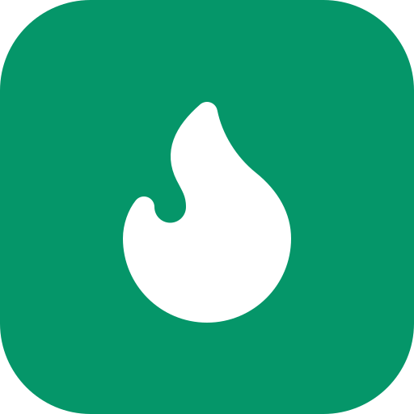

# NutriScan

**Monitorizare nutrițională cu recunoașterea etichetelor alimentare prin OCR**

Jurnal alimentar, rețete, planificator de mese, listă de cumpărături și statistici,<br/>
într-o aplicație web instalabilă pe telefon (PWA), cu un microserviciu de vedere artificială pentru citirea etichetelor.

[](https://github.com/muxxq/Nutritional-Tracking-with-OCR/actions/workflows/backend-ci.yml)
[](https://github.com/muxxq/Nutritional-Tracking-with-OCR/actions/workflows/client-ci.yml)
<br/>


[Funcționalități](#-funcționalități) ·
[Capturi de ecran](#-capturi-de-ecran) ·
[Pornire rapidă](#-pornire-rapidă) ·
[Arhitectură](#️-arhitectură) ·
[Documentație](#-documentație)

<br/>

<picture>
  <source media="(prefers-color-scheme: dark)" srcset=".github/assets/hero-dark.png" />
  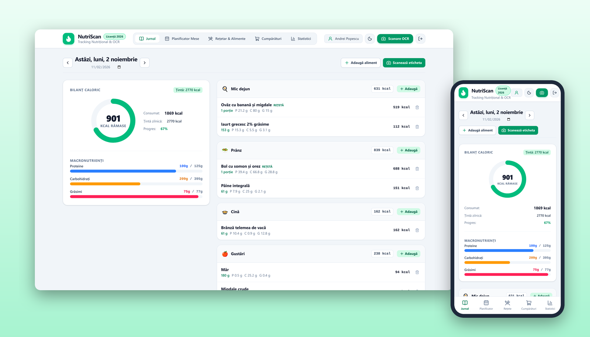
</picture>

</div>

---

## 📖 Despre proiect

Majoritatea aplicațiilor de nutriție cer introducerea manuală a valorilor de pe etichetă, ceea ce e lent și predispus la erori. **NutriScan** propune un flux în care utilizatorul fotografiază tabelul nutrițional, un microserviciu OCR extrage valorile per 100 g împreună cu un grad de încredere, iar utilizatorul confirmă sau corectează câmpurile marcate ca nesigure înainte de salvare (*human-in-the-loop*).

În jurul acestui flux, aplicația oferă tot ce e necesar pentru urmărirea zilnică a alimentației: ținte calorice calculate din profilul fizic, jurnal pe mese, rețete cu valori calculate automat, planificare săptămânală și statistici.

| | |
|---|---|
| **Universitatea** | Universitatea din Craiova |
| **Facultatea** | Automatică, Calculatoare și Electronică (ACE), Departamentul Calculatoare |
| **Student** | Maximilian Andrei |
| **Coordonator științific** | Dr. Ing. Mocanu Lucian-Mihai |

---

## ✨ Funcționalități

| | Modul | Ce face |
|---|---|---|
| 👤 | **Profil și ținte** | Calculează metabolismul bazal (Mifflin–St Jeor), necesarul zilnic (TDEE) și țintele de proteine, carbohidrați și grăsimi din vârstă, înălțime, greutate, activitate și obiectiv. Orice țintă poate fi suprascrisă manual. |
| 📒 | **Jurnal alimentar** | Alimente și rețete pe 4 mese (mic dejun, prânz, cină, gustări), cu inel caloric și bare de macronutrienți raportate la ținte. |
| 🥫 | **Catalog de alimente** | Catalog inițial verificat plus alimente proprii. La introducerea manuală, avertizează dacă energia declarată diferă cu peste 15% de `4P + 4C + 9G`. |
| 🍲 | **Rețetar** | Rețete din mai multe ingrediente; valorile per porție se calculează automat, iar rețeta se adaugă în jurnal în porții. |
| 🗓️ | **Planificator de mese** | Plan pe săptămână, cu starea fiecărei zile față de țintă (sub / în / peste) și trecerea unei mese în jurnal cu un clic. |
| 🛒 | **Listă de cumpărături** | Generată din planul săptămânii, cu cantități agregate și grupate pe categorii; articole bifabile și adăugare manuală. |
| 📊 | **Statistici** | Medii săptămânale și lunare, abaterea față de țintă și caloriile pe zi într-un grafic. |
| 📷 | **Scanare OCR** | Fotografierea etichetei și precompletarea formularului cu valorile extrase și gradul de încredere. *În lucru*, vezi [Stadiul proiectului](#-stadiul-proiectului). |
| 🌗 | **Temă și PWA** | Temă luminoasă / întunecată, interfață adaptivă desktop–mobil, instalabilă pe ecranul telefonului. |
| 🔐 | **Securitate** | Autentificare JWT cu refresh token în cookie `HttpOnly`, limitare a încercărilor de autentificare, parole hash-uite. |

---

## 📸 Capturi de ecran

<table>
  <tr>
    <td width="50%">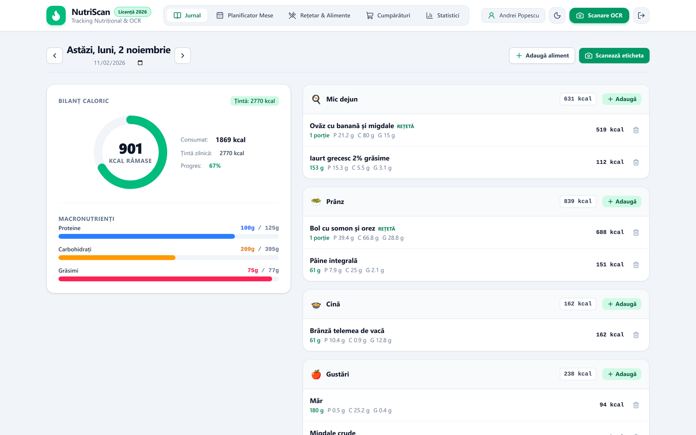<p align="center"><b>Jurnal</b>: bilanț caloric și macronutrienți</p></td>
    <td width="50%">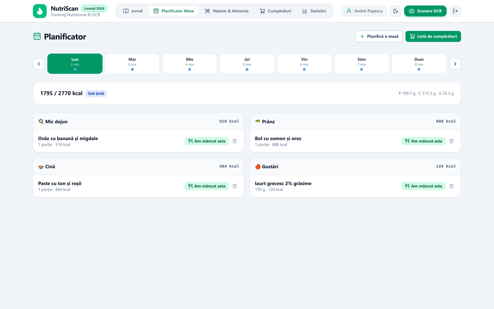<p align="center"><b>Planificator</b>: mesele săptămânii față de țintă</p></td>
  </tr>
  <tr>
    <td>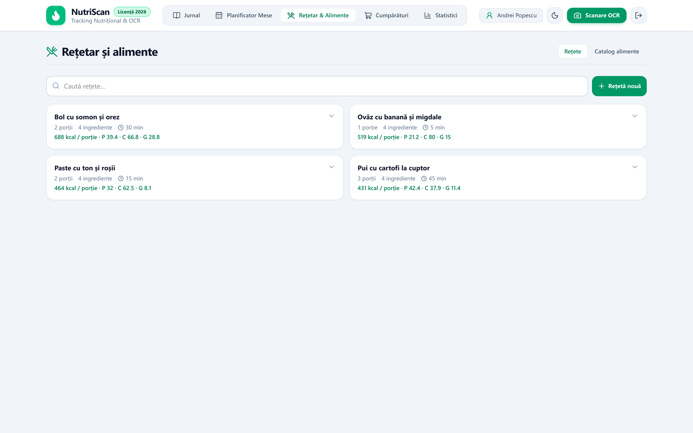<p align="center"><b>Rețetar</b>: valori per porție calculate automat</p></td>
    <td>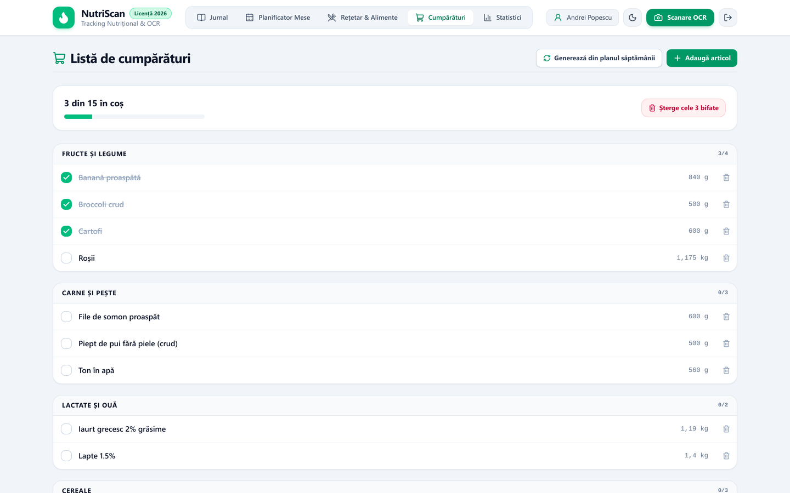<p align="center"><b>Listă de cumpărături</b>: generată din plan</p></td>
  </tr>
  <tr>
    <td>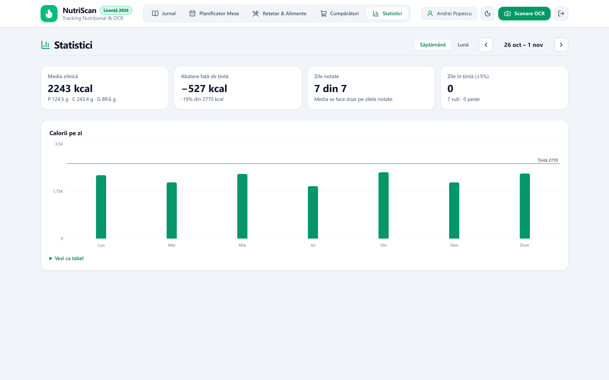<p align="center"><b>Statistici</b>: calorii pe zi și medii</p></td>
    <td>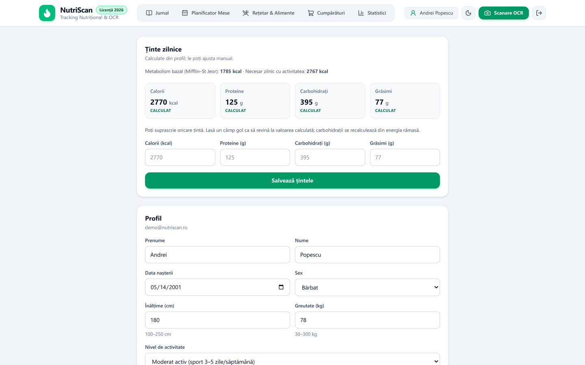<p align="center"><b>Profil</b>: BMR, TDEE și ținte calculate</p></td>
  </tr>
</table>

<details>
<summary><b>🌙 Tema întunecată</b></summary>
<br/>
<table>
  <tr>
    <td width="50%">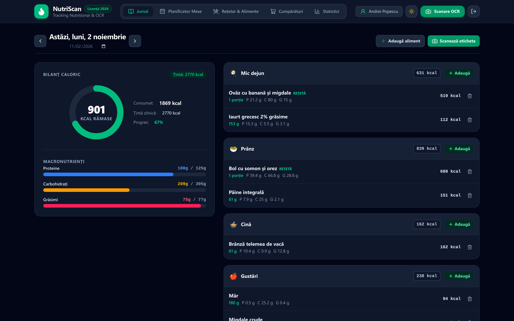</td>
    <td width="50%">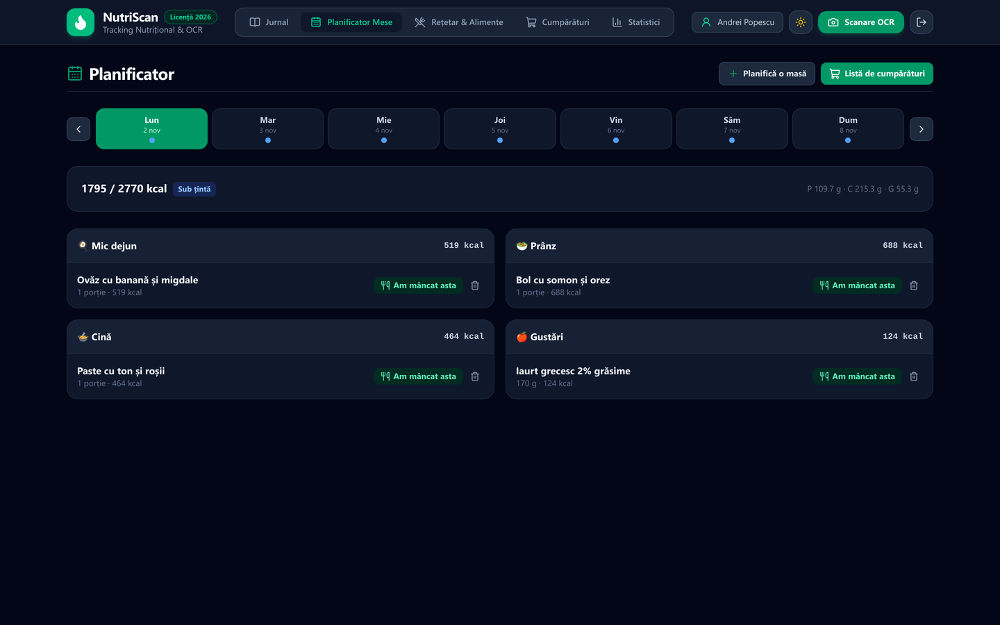</td>
  </tr>
  <tr>
    <td>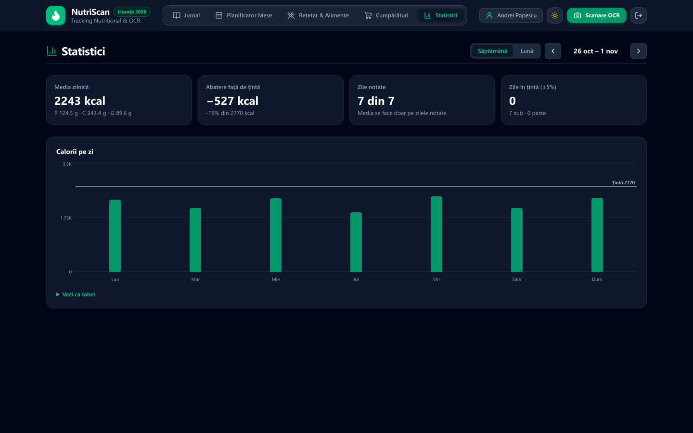</td>
    <td>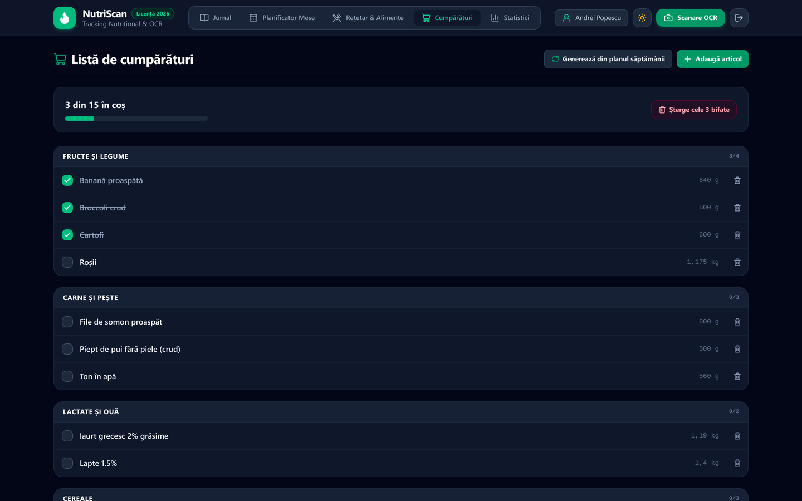</td>
  </tr>
</table>
</details>

<details open>
<summary><b>📱 Pe telefon (PWA)</b></summary>
<br/>
<p align="center">
  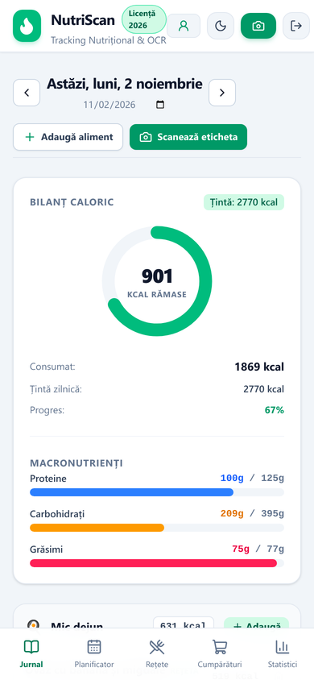
  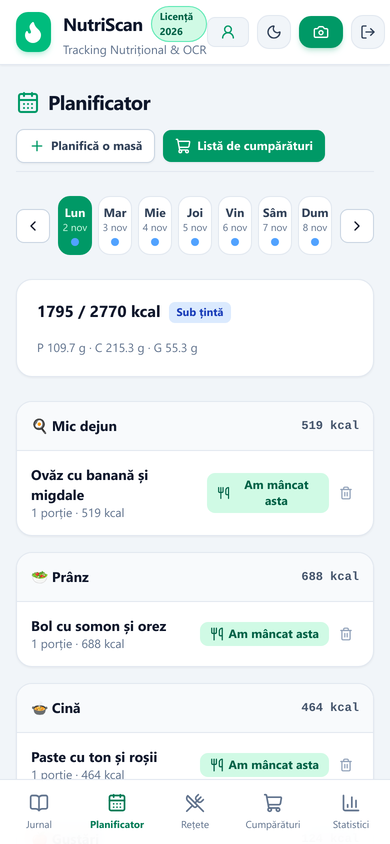
  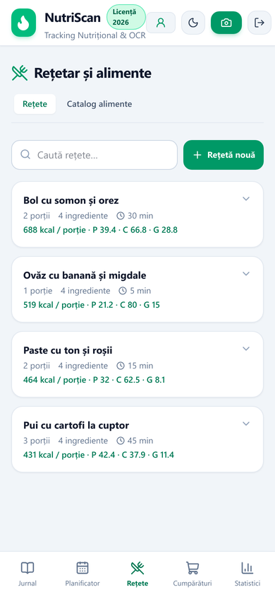
  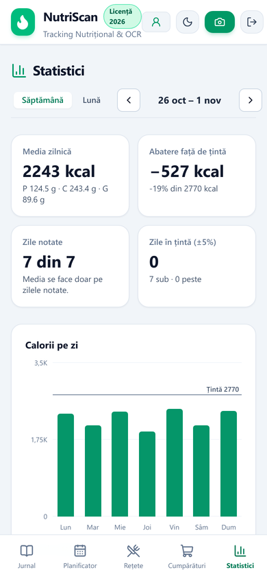
  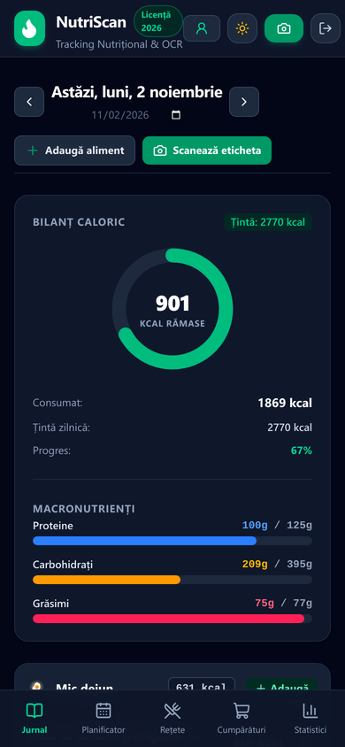
</p>
</details>

---

## 🚀 Pornire rapidă

Toată aplicația (bază de date, backend, serviciu OCR și interfață) pornește cu o singură comandă Docker. **Nu este nevoie** de .NET, Node.js, Python sau PostgreSQL instalate local.

### Cerințe

- [Docker Desktop](https://www.docker.com/products/docker-desktop/) (Windows / macOS) sau Docker Engine cu Compose v2 (Linux)
- [Git](https://git-scm.com/downloads)
- Porturile libere `3000`, `5000`, `8000` și `5432`

### 1. Clonare și configurare

```bash
git clone https://github.com/muxxq/Nutritional-Tracking-with-OCR.git
cd Nutritional-Tracking-with-OCR/aplicatie
cp .env.example .env          # Windows (cmd): copy .env.example .env
```

Fișierul `.env` conține parola bazei de date și secretul JWT. Valorile implicite sunt suficiente pentru rulare locală; pentru orice altceva, generați valori noi cu `openssl rand -hex 32`.

### 2. Pornire

```bash
docker compose up -d --build
```

Prima pornire durează câteva minute (se descarcă imaginile și se compilează backend-ul). Backend-ul creează automat schema bazei de date și încarcă un catalog inițial de alimente. Verificați cu `docker compose ps` că toate cele patru containere (`nutriscan-db`, `nutriscan-ocr`, `nutriscan-backend`, `nutriscan-client`) sunt `Up`.

### 3. Deschidere

| Ce | Adresă |
|---|---|
| 🖥️ **Aplicația** | **http://localhost:3000** |
| 📘 Documentația API (Swagger) | http://localhost:5000/swagger |
| 🔬 Documentația serviciului OCR | http://localhost:8000/docs |

Creați un cont din pagina **Înregistrare** și completați profilul.

### 4. Date demo (opțional)

Pentru a explora aplicația direct cu date realiste (3 săptămâni de jurnal, rețete, plan și listă de cumpărături, ca în capturile de mai sus):

```bash
python3 scripts/seed_demo.py   # Windows: python scripts\seed_demo.py
```

Apoi autentificați-vă cu **`demo@nutriscan.ro`** / **`Demo1234!`**. Scriptul folosește doar biblioteca standard Python 3.8+ și poate fi rulat de mai multe ori fără să dubleze datele.

### Oprire

```bash
docker compose down        # oprește containerele, păstrează datele
docker compose down -v     # oprește containerele și șterge baza de date
```

<details>
<summary><b>🔧 Probleme frecvente</b></summary>

- **Portul 5432 este ocupat** (există deja un PostgreSQL local): în `aplicatie/.env` setați `POSTGRES_PORT=5433` și reporniți cu `docker compose up -d`.
- **Pagina nu se încarcă imediat după pornire:** backend-ul are nevoie de câteva secunde ca să aplice migrările. Jurnalele se văd cu `docker compose logs backend`.
- **Date vechi incompatibile după o actualizare a repository-ului:** `docker compose down -v`, apoi `docker compose up -d --build`.
- **„Prea multe încercări” la autentificare:** endpoint-urile de autentificare sunt limitate pe IP (protecție brute-force); așteptați un minut.

</details>

<details>
<summary><b>🧭 Scenariu de test sugerat</b></summary>

1. **Înregistrare** (parolă de minimum 8 caractere), apoi completarea profilului fizic. Țintele calculate apar în pagina **Profil**.
2. **Jurnal:** adăugați alimente la una dintre mese, căutând în catalog (ex. „ou”, „ovăz”, „banană”). Inelul caloric și barele de macronutrienți se actualizează.
3. **Aliment nou:** din fereastra de adăugare, creați un aliment cu valorile de pe o etichetă. Dacă energia diferă cu peste 15% de `4P + 4C + 9G`, apare un avertisment.
4. **Rețete:** creați o rețetă din mai multe ingrediente și adăugați-o în jurnal în porții.
5. **Planificator:** planificați mese pe săptămână; „Am mâncat asta” trece masa în jurnal.
6. **Listă de cumpărături:** generați lista din plan și bifați articolele.
7. **Statistici:** comparați caloriile pe zi cu ținta, pe săptămână și pe lună.

Pe un ecran îngust (sau în modul mobil al instrumentelor de dezvoltare ale browserului) apare bara de navigare de jos, ca pe telefon. Din meniul browserului, aplicația se poate instala ca PWA.

</details>

<details>
<summary><b>🧪 Teste automate</b></summary>

Necesită [.NET 8 SDK](https://dotnet.microsoft.com/download/dotnet/8.0) și [Node.js 22](https://nodejs.org/). Testele de integrare pornesc singure un PostgreSQL temporar prin Docker (Testcontainers).

```bash
# Backend: teste unitare și de integrare
cd aplicatie/backend
dotnet test

# Client: teste de componente
cd aplicatie/client
npm ci
npm test
```

Aceleași teste rulează în GitHub Actions la fiecare push ([`.github/workflows/`](.github/workflows/)).

</details>

---

## 🏛️ Arhitectură

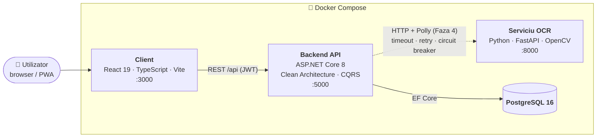

- **Backend decuplat de OCR:** backend-ul vorbește cu serviciul OCR printr-un port (interfață) din stratul Application. Dacă serviciul OCR cade, aplicația rămâne funcțională, iar utilizatorul introduce valorile manual. Deocamdată portul este implementat de un stub care răspunde „OCR indisponibil”; în Faza 4 devine un client HTTP cu politici Polly, schimbând doar înregistrarea din DI (linia punctată din diagramă) ([ADR-001](aplicatie/docs/adr/ADR-001-clean-architecture-and-ocr-decoupling.md), [ADR-010](aplicatie/docs/adr/ADR-010-ocr-port-and-stub.md)).
- **Clean Architecture** pe patru straturi (`Domain`, `Application`, `Infrastructure`, `WebApi`), cu dependențe orientate spre domeniu; cazurile de utilizare sunt comenzi și interogări **CQRS** (MediatR), validate cu FluentValidation.
- **Client same-origin:** interfața apelează `/api` prin proxy, iar access token-ul stă doar în memorie, nu în `localStorage` ([ADR-002](aplicatie/docs/adr/ADR-002-authentication-strategy.md), [ADR-011](aplicatie/docs/adr/ADR-011-client-architecture.md)).

### Tehnologii

| Componentă | Tehnologii |
|---|---|
| **Client** | React 19, TypeScript, Vite, Tailwind CSS, TanStack Query, Recharts, `vite-plugin-pwa` |
| **Backend** | ASP.NET Core 8, Entity Framework Core, Npgsql, MediatR, FluentValidation, JWT, Swagger |
| **OCR** | Python, FastAPI, OpenCV, NumPy, Pillow |
| **Date** | PostgreSQL 16 |
| **Infrastructură** | Docker Compose, GitHub Actions |
| **Teste** | xUnit, Testcontainers, Vitest, Testing Library, pytest |

---

## 📍 Stadiul proiectului

| Componentă | Stadiu |
|---|---|
| Backend API | ✅ Funcțional: autentificare, profil și ținte, catalog, jurnal, rețete, planificator, listă de cumpărături, statistici |
| Client PWA | ✅ Funcțional pe API-ul real; toate ecranele de mai sus, temă dark / light, instalabil |
| Serviciu OCR | 🚧 Schelet funcțional; pipeline-ul de recunoaștere este în lucru (Faza 4) |
| Lucrarea scrisă | 🚧 SRS finalizat; capitolele în redactare |

Până la finalizarea OCR-ului, butonul **Scanează eticheta** răspunde „OCR indisponibil” și deschide formularul de adăugare manuală, exact comportamentul proiectat pentru cazul în care serviciul OCR nu este disponibil. Planul complet: [ROADMAP.md](ROADMAP.md).

---

## 📚 Documentație

| Document | Conținut |
|---|---|
| [ROADMAP.md](ROADMAP.md) | Planul pe faze și stadiul fiecăreia |
| [aplicatie/docs/adr/](aplicatie/docs/adr/) | 13 decizii de arhitectură (ADR) |
| [aplicatie/docs/architecture_and_contracts.md](aplicatie/docs/architecture_and_contracts.md) | Arhitectura și contractele dintre servicii |
| [aplicatie/docs/sprints/](aplicatie/docs/sprints/) | Ce s-a livrat în fiecare sprint |
| [documentatie/srs/](documentatie/srs/) | Specificația cerințelor software (SRS, IEEE 830) |
| [aplicatie/README.md](aplicatie/README.md) | Detalii tehnice despre module |

### Structura repository-ului

```text
├── aplicatie/
│   ├── docker-compose.yml     # pornește toate cele 4 servicii
│   ├── .env.example           # model pentru configurația locală
│   ├── backend/               # ASP.NET Core 8 (Domain, Application, Infrastructure, WebApi) + teste
│   ├── client/                # React + TypeScript PWA
│   ├── ocr-service/           # microserviciu Python (FastAPI + OpenCV)
│   ├── scripts/seed_demo.py   # populează un cont demo
│   └── docs/                  # ADR-uri, specificații, rezumate de sprint
├── documentatie/              # materiale academice (SRS, prototip vizual)
└── ROADMAP.md
```

---

<div align="center">
<sub>Lucrare de licență · Universitatea din Craiova, Facultatea ACE · 2026</sub>
</div>
