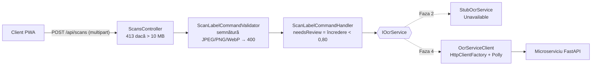

# ADR-010: Portul `IOcrService`, Implementarea Stub și Endpoint-ul de Scanare

* **Status:** Acceptat (Accepted)
* **Data:** 2026-10-17
* **Autor:** Maximilian Andrei (Student)
* **Coordonator:** Dr. Ing. Mocanu Lucian-Mihai
* **Cerințe SRS:** UC01, FR-03, FR-05, NFR-09, NFR-12
* **Spec:** [2026-10-17-ocr-contract-design.md](../specs/2026-10-17-ocr-contract-design.md)
* **Legat de:** [ADR-001](ADR-001-clean-architecture-and-ocr-decoupling.md) (decuplarea OCR), replanificarea din 16.10.2026 (OCR în Faza 4)

---

## 1. Context și Enunțul Problemei
Replanificarea din 16.10.2026 a mutat OCR-ul în Faza 4 (săptămânile 11–15), după clientul integrat. Clientul trebuie totuși să construiască din Faza 3 ecranul de scanare și formularul *Human-in-the-Loop*, iar integrarea de mai târziu nu trebuie să modifice codul deja testat. ADR-001 a stabilit că OCR-ul este un microserviciu separat, apelat prin HTTP din Infrastructure. Rămânea de stabilit **contractul din interiorul backend-ului**: ce cere Application și ce primește clientul.

---

## 2. Deciziile Luate

| # | Decizie | Alternative respinse și motivul |
|---|---|---|
| D1 | **Portul vorbește limbajul formularului de aliment** (aceleași 8 câmpuri ca `FoodItem`, fiecare cu valoare și încredere); traducerea JSON-ului Python este treaba adaptorului | Copierea JSON-ului serviciului Python în Application: schimbările microserviciului s-ar propaga până în client |
| D2 | **Stub-ul întoarce `Unavailable`** cu câmpuri goale | Valori inventate: testare pe date false, demo înșelător. `NotImplementedException`: eroare 500 |
| D3 | **OCR indisponibil → 200 cu `status = "unavailable"`** și mesaj | 503: un formular gol este un rezultat valid al ecranului, nu o eroare |
| D4 | **Dimensiunea → 413** (filtru înaintea model binding-ului + controller); **tipul real → 400**, verificat după semnătura binară în validatorul comenzii | `Content-Type` sau extensia: vin de la client și pot fi falsificate (OWASP *Unrestricted File Upload*) |
| D5 | **JPEG, PNG și WebP**, ca în contractul OCR înghețat | HEIC (SRS NFR-09): OpenCV nu îl decodează fără biblioteci suplimentare, iar clientul comprimă în JPEG înainte de upload (NFR-02) |
| D6 | **Pragul FR-05 (0,80) este o constantă din Application**, expusă clientului ca `needsReview` | Pragul în client: regula s-ar duplica și n-ar putea fi calibrată pe rezultatele măsurate ale motorului |

**Porturi și adaptoare (D1).** `IOcrService` este un *port* în sensul arhitecturii hexagonale: Application declară de ce are nevoie, cu tipurile sale (`OcrResult`, `OcrField`, `ImageFormat`), iar Infrastructure furnizează *adaptorul*. Adaptorul real din Faza 4 face și rolul de *anti-corruption layer*: de exemplu, serviciul Python raportează `sodium`, dar formularul are `saltGrams`, deci conversia `sare = sodiu × 2,5` stă în adaptor, nu în Application sau în client.

**Ce se schimbă în Faza 4.** O singură linie în `Infrastructure/DependencyInjection.cs` (înregistrarea `StubOcrService` devine un `HttpClient` tipizat cu politici Polly) și o clasă nouă, adaptorul. Controller-ul, comanda, validatorul, DTO-ul și testele lor rămân neschimbate. Un serviciu OCR căzut sau un circuit breaker deschis întoarce tot `OcrResult.Unavailable`, deci clientul are de la început o singură cale pentru „OCR indisponibil”.

**Validarea fișierului (D4) pe straturi:**
1. Kestrel: `RequestSizeLimit` (10 MB + 64 KB pentru plicul multipart) oprește corpurile foarte mari înainte de a fi încărcate în memorie.
2. `PayloadTooLargeAttribute`: citește formularul înaintea model binding-ului și transformă depășirea limitei în 413 (altfel ASP.NET ar întoarce un 400 generic).
3. Controller: fișier lipsă sau gol → 400; mai mare de 10 MB → 413.
4. Validatorul comenzii: aceleași limite (a doua linie de apărare, pentru orice alt apelant) și semnătura binară.

Imaginea este citită într-un `byte[]` și transmisă portului; nu este scrisă pe disc sau în baza de date (SRS §6.4, minimizarea datelor).

---

## 3. Consecințe

### Pozitive
* **Clientul se poate construi complet în Faza 3**, inclusiv calea de degradare NFR-12, pe contractul final.
* **Integrarea din Faza 4 este localizată:** un adaptor nou și o linie de DI (principiul *Open/Closed*).
* **Validarea fișierelor este testată** (semnături valide și invalide, 400, 413, 401), deci auditul OWASP din Faza 5 are deja dovezi.

### Riscuri asumate
* **HEIC nu este acceptat** (abatere de la NFR-09, justificată în D5); trebuie verificat pe iPhone fizic în Faza 3 că imaginea ajunge ca JPEG.
* **Limita de scanări per utilizator** nu există încă; devine necesară în Faza 4, când fiecare cerere costă timp de procesor.
* **Pragul de 0,80 este provizoriu** și se calibrează pe dataset-ul de etichete în Faza 4.
