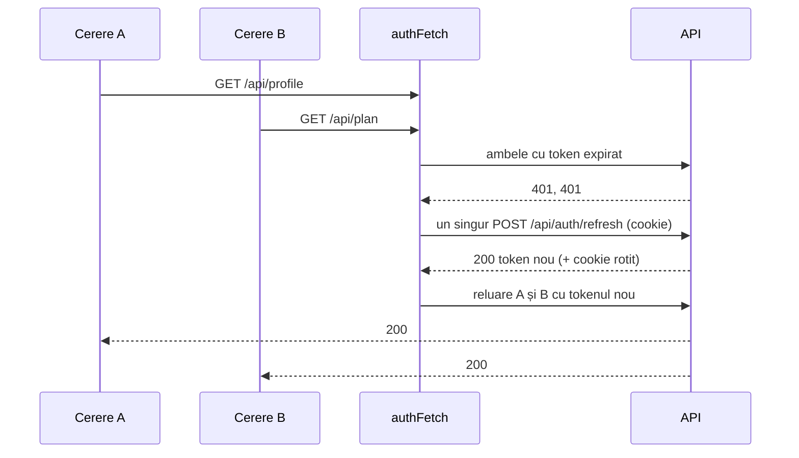

# ADR-011: Arhitectura Clientului: Tipuri Generate din OpenAPI, Server-State în TanStack Query, Sesiune în Memorie

* **Status:** Acceptat (Accepted)
* **Data:** 2026-10-17
* **Autor:** Maximilian Andrei (Student)
* **Coordonator:** Dr. Ing. Mocanu Lucian-Mihai
* **Cerințe SRS:** FR-01 (sesiune), NFR-06 (JWT + refresh), NFR-15 (utilizabilitate)
* **Jira:** NUT-27 (arhitectura clientului), NUT-46 (client HTTP și autentificare)
* **Legat de:** [ADR-002](ADR-002-authentication-strategy.md) (JWT + refresh token rotativ)

---

## 1. Context și Enunțul Problemei
Clientul React din Faza 1 rula complet pe `mockData.ts`: o singură componentă `App` ținea toată starea în `useState`, fără rutare și fără apeluri HTTP. Faza 3 îl conectează la API-ul real. Înainte de primul ecran trebuiau stabilite:
1. cum rămân tipurile din client sincronizate cu contractul API;
2. unde stau datele venite de la server și cum se reîmprospătează;
3. unde stă tokenul de acces și cum se reînnoiește fără ca utilizatorul să observe;
4. cum vorbește clientul cu API-ul în dezvoltare (CORS, cookie).

---

## 2. Deciziile Luate

| # | Decizie | Alternative respinse și motivul |
|---|---|---|
| D1 | **Tipurile se generează din contractul OpenAPI** (`openapi-typescript`), iar apelurile se fac prin `openapi-fetch`, verificat la compilare. Contractul e salvat în repo (`backend/openapi.json`) și un test backend pică dacă API-ul se schimbă fără regenerare | Tipuri scrise de mână: se desincronizează în tăcere. Axios + tipuri manuale: aceeași problemă. Generatoare de hook-uri (Orval): mai mult cod generat de întreținut |
| D2 | **Datele de la server în TanStack Query** (cache pe cheie, invalidare după mutații); **starea locală a clientului în Zustand**, doar sesiunea | Redux Toolkit: boilerplate pentru o stare de client foarte mică. `useState` în `App`: datele server copiate local devin învechite și nu se invalidează |
| D3 | **Access token-ul doar în memorie**; la pornire, un `POST /api/auth/refresh` restaurează sesiunea din cookie-ul HttpOnly | `localStorage`: un XSS ar putea citi tokenul (ADR-002). `sessionStorage`: același risc, plus pierderea între tab-uri |
| D4 | **Reînnoire reactivă cu un singur refresh în zbor**: la un 401, toate cererile concurente așteaptă același refresh, apoi sunt reluate o dată | Refresh separat pentru fiecare cerere: serverul rotește refresh token-ul, deci al doilea refresh ar folosi un token deja rotit și ar fi tratat ca furt (revocarea familiei, ADR-002). Refresh preventiv pe timer: mai complex, și tot e nevoie de calea reactivă |
| D5 | **API-ul pe aceeași origine în dezvoltare**: Vite face proxy pentru `/api` către backend | Cereri cross-origin direct la `:5000`: necesită CORS cu credențiale în fiecare mediu și complică cookie-ul de refresh |
| D6 | **React Router 7 (mod declarativ)**, rute protejate de o componentă gardă | TanStack Router: rute complet tipizate, dar configurare și generare de cod în plus pentru câteva ecrane |
| D7 | **Migrare ecran cu ecran**: ecranele încă neconectate primesc datele mock printr-un hook temporar (`useMockData`), șters la final | Rescrierea tuturor ecranelor deodată: o ramură lungă, imposibil de verificat incremental |

**De ce contează D4 (secvența).** Trei cereri pornesc simultan cu un token expirat și primesc 401. Fără coordonare, fiecare ar trimite propriul refresh cu același cookie RT1. Primul reușește și primește RT2, al doilea prezintă RT1 deja revocat, iar serverul revocă toată familia: utilizatorul e delogat pe toate dispozitivele. Cu un singur `Promise` partajat, se face un singur refresh și toate trei reiau cererea cu noul token. Testul `shares one refresh between concurrent 401s` verifică exact acest caz.

**Contractul ca fișier (D1).** `backend/openapi.json` este generat din API-ul real. Testul `CommittedOpenApiContract_MatchesTheApi` îl compară cu Swagger-ul servit și pică la orice diferență, deci schimbarea contractului apare explicit în diff. `npm run api:types` regenerează `client/src/api/schema.d.ts`. Ca tipurile să fie exacte, Swagger publică acum nulabilitatea din C# (`SupportNonNullableReferenceTypes`), iar proprietățile ne-nule sunt marcate obligatorii. Exemplu: `name: string`, dar `quantityText?: string | null`.

---

## 3. Consecințe

### Pozitive
* **O schimbare de contract nu mai poate trece neobservată:** pică testul backend, iar regenerarea tipurilor face compilatorul TypeScript să arate fiecare loc afectat din client.
* **Sesiunea e sigură și invizibilă:** tokenul nu atinge stocarea persistentă, iar reîncărcarea paginii nu cere parola.
* **Logica sensibilă e testată:** refresh unic, reluarea cererii cu corpul intact, delogare la eșec, fără refresh pe rutele de autentificare.

### Riscuri asumate
* **Cookie-ul `Secure` pe HTTP** funcționează doar pe `localhost`. Testarea pe telefon prin IP-ul din rețeaua locală cere HTTPS, care oricum e necesar pentru PWA (NUT-33).
* **Ecranele mock coexistă temporar** cu cele reale (D7), până la eliminarea `mockData.ts`.
* **`openapi-typescript` cere TypeScript 5** ca dependență peer; rulează prin `npx` cu versiune fixată, separat de TypeScript 6 al proiectului.
