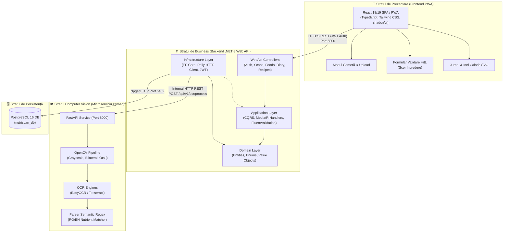
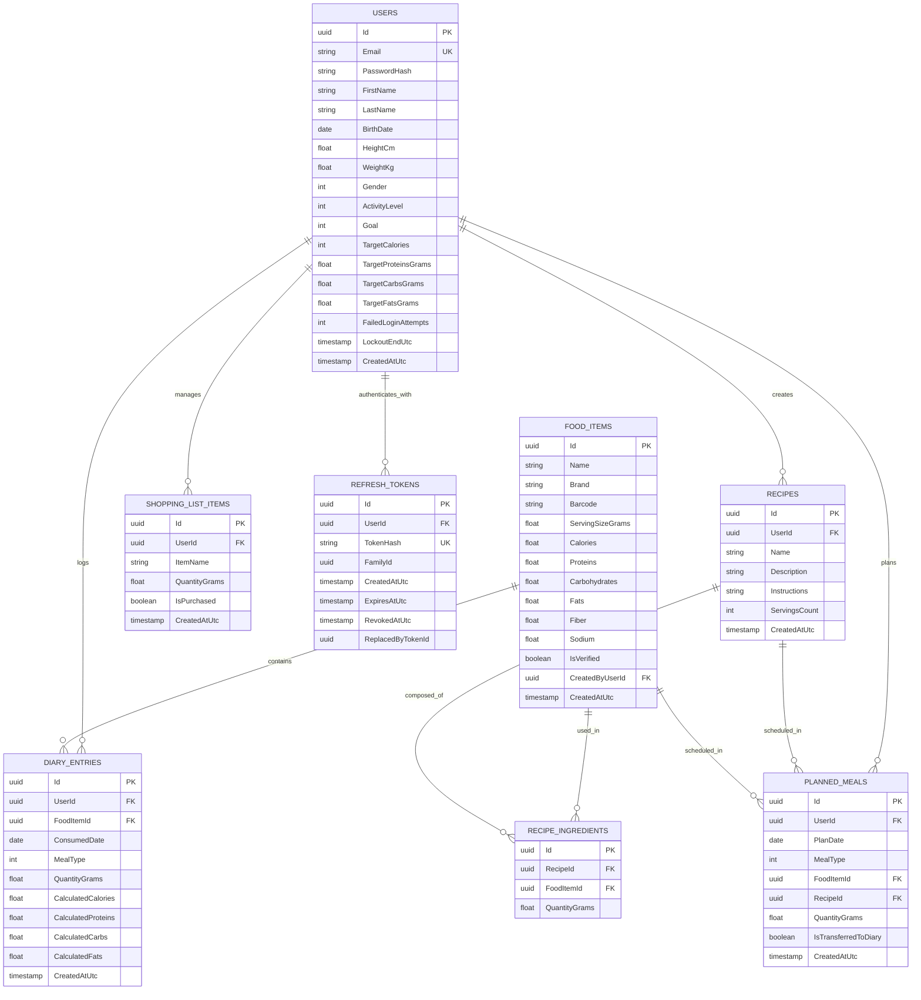
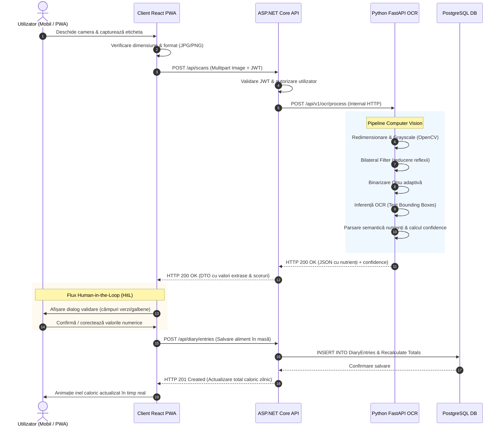
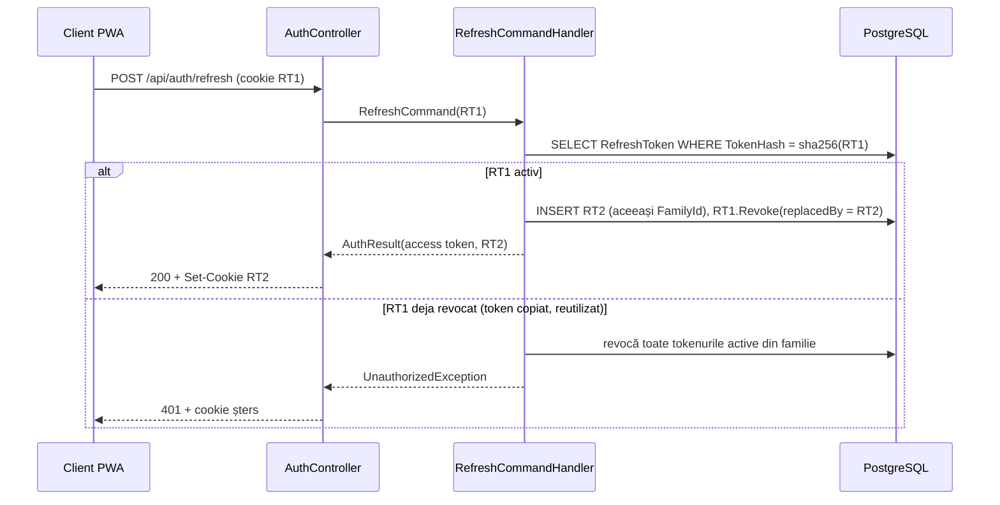

# 🏛️ Arhitectura Sistemului, Diagrame Tehnice & Contracte API
**Documentație Tehnică de Proiectare — Lucrare de Licență NutriScan**  
**Corelat cu:** [NUT-12](https://maximilianandrei2101.atlassian.net/browse/NUT-12) & Capitolele 3 și 4 din Teză

---

## 1. Diagrama de Pachete și Componente a Sistemului

Următoarea diagramă ilustrează decuplarea componentelor și fluxul de date între containerele Docker:



---

## 2. Diagrama Entitate-Relație (ERD) — Baza de Date PostgreSQL

Structura relațională implementată prin Entity Framework Core (`InitialCreate`):



---

## 3. Diagrama de Secvență: Fluxul de Scanare OCR Human-in-the-Loop



---

## 4. Contractul OpenAPI Înghețat (API ↔ OCR)

### Endpoint: `POST /api/v1/ocr/process`
* **Content-Type:** `multipart/form-data`
* **Request Payload:**
  * `file`: Fișier binar imagine (`image/jpeg`, `image/png`, `image/webp`), maxim 10 MB.
* **Exemplu Răspuns (HTTP 200 OK):**
```json
{
  "success": true,
  "calories": {
    "value": 389.0,
    "confidence": 0.95,
    "unit": "kcal"
  },
  "proteins": {
    "value": 16.9,
    "confidence": 0.92,
    "unit": "g"
  },
  "carbohydrates": {
    "value": 66.3,
    "confidence": 0.88,
    "unit": "g"
  },
  "fats": {
    "value": 6.9,
    "confidence": 0.94,
    "unit": "g"
  },
  "fiber": {
    "value": 10.6,
    "confidence": 0.78,
    "unit": "g"
  },
  "sodium": {
    "value": 0.02,
    "confidence": 0.70,
    "unit": "g"
  },
  "serving_base": "100g",
  "overall_confidence": 0.86,
  "raw_text": "Valoare energetica: 389 kcal\nGrasimi: 6.9 g\nCarbohidrati: 66.3 g\nProteine: 16.9 g\nSare: 0.02 g",
  "processing_time_ms": 340.5
}
```

---

## 5. Autentificare: JWT + Refresh Token Rotativ

Decizia completă și alternativele respinse: [ADR-002](adr/ADR-002-authentication-strategy.md). Design detaliat: [spec](specs/2026-10-16-auth-jwt-design.md).

### Contract `/api/auth`

| Metodă și rută | Auth | Corp cerere | Succes | Erori |
|---|---|---|---|---|
| `POST /register` | — | `{ email, password, firstName, lastName }` | 201 `AuthResponse` + cookie | 400, 409, 429 |
| `POST /login` | — | `{ email, password }` | 200 `AuthResponse` + cookie | 400, 401, 429 |
| `POST /refresh` | cookie | — | 200 `AuthResponse` + cookie nou | 401 (+ cookie șters), 429 |
| `POST /logout` | cookie (opțional) | — | 204 + cookie șters | 429 |
| `GET /me` | Bearer | — | 200 `UserDto` | 401 |

* **`AuthResponse`:** `{ accessToken, accessTokenExpiresAtUtc, user: { id, email, firstName, lastName, isProfileComplete } }`
* **Access token:** JWT HS256, valabil 15 minute, păstrat de client **doar în memorie**.
* **Refresh token:** cookie `nutriscan_rt; HttpOnly; Secure; SameSite=Strict; Path=/api/auth`, valabil 7 zile, rotit la fiecare folosire. În baza de date se salvează doar hash-ul SHA-256.
* **Erori:** toate sunt `application/problem+json` (RFC 7807).

### Diagrama de secvență: rotație și detectarea reutilizării


