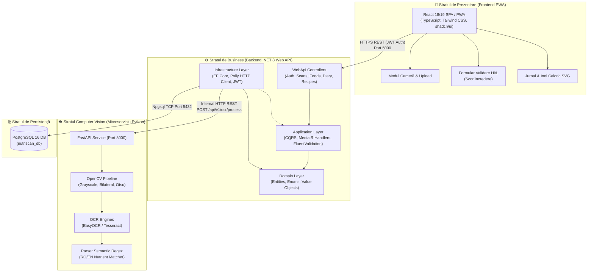
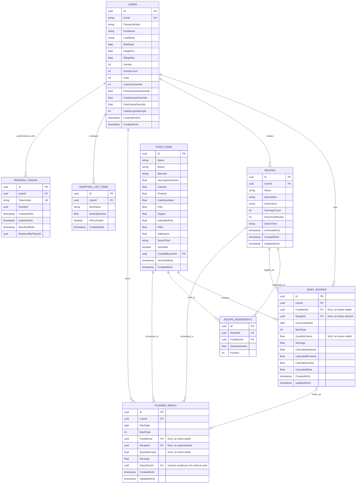
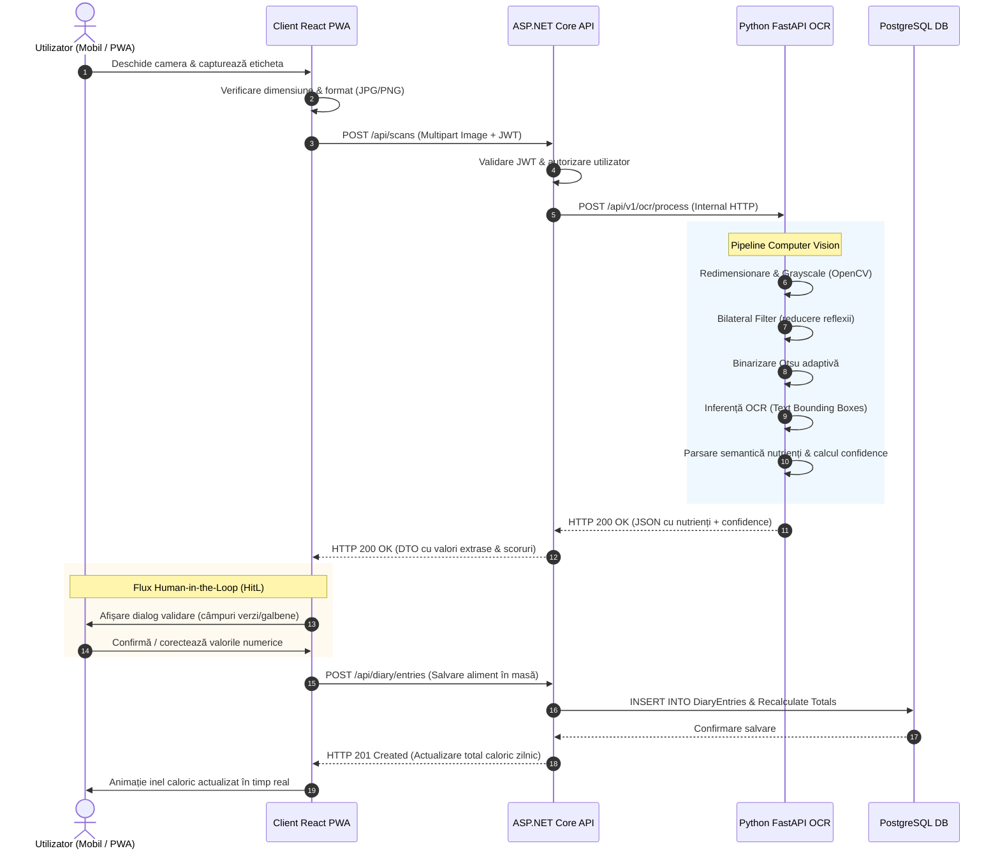
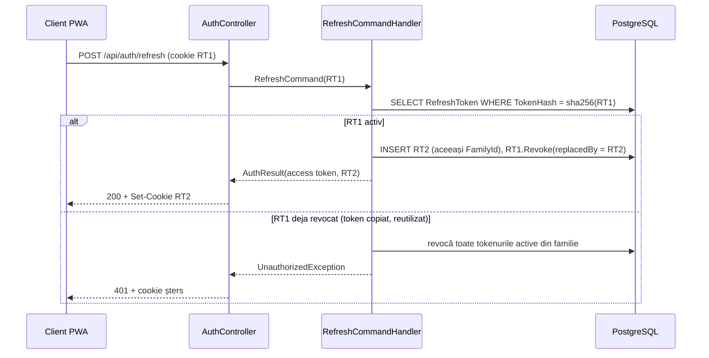
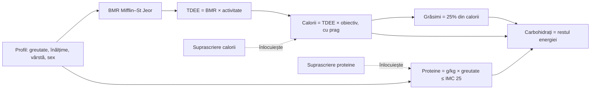

# 🏛️ Arhitectura Sistemului, Diagrame Tehnice & Contracte API
**Documentație Tehnică de Proiectare — Lucrare de Licență NutriScan**  
**Corelat cu:** [NUT-12](https://maximilianandrei2101.atlassian.net/browse/NUT-12) & Capitolele 3 și 4 din Teză

---

## 1. Diagrama de Pachete și Componente a Sistemului

Următoarea diagramă ilustrează decuplarea componentelor și fluxul de date între containerele Docker:



---

## 2. Diagrama Entitate-Relație (ERD) — Baza de Date PostgreSQL

Structura relațională implementată prin Entity Framework Core (`InitialCreate`):



---

## 3. Diagrama de Secvență: Fluxul de Scanare OCR Human-in-the-Loop



---

## 4. Contractul OpenAPI Înghețat (API ↔ OCR)

### Endpoint: `POST /api/v1/ocr/process`
* **Content-Type:** `multipart/form-data`
* **Request Payload:**
  * `file`: Fișier binar imagine (`image/jpeg`, `image/png`, `image/webp`), maxim 10 MB.
* **Exemplu Răspuns (HTTP 200 OK):**
```json
{
  "success": true,
  "calories": {
    "value": 389.0,
    "confidence": 0.95,
    "unit": "kcal"
  },
  "proteins": {
    "value": 16.9,
    "confidence": 0.92,
    "unit": "g"
  },
  "carbohydrates": {
    "value": 66.3,
    "confidence": 0.88,
    "unit": "g"
  },
  "fats": {
    "value": 6.9,
    "confidence": 0.94,
    "unit": "g"
  },
  "fiber": {
    "value": 10.6,
    "confidence": 0.78,
    "unit": "g"
  },
  "sodium": {
    "value": 0.02,
    "confidence": 0.70,
    "unit": "g"
  },
  "serving_base": "100g",
  "overall_confidence": 0.86,
  "raw_text": "Valoare energetica: 389 kcal\nGrasimi: 6.9 g\nCarbohidrati: 66.3 g\nProteine: 16.9 g\nSare: 0.02 g",
  "processing_time_ms": 340.5
}
```

---

## 5. Autentificare: JWT + Refresh Token Rotativ

Decizia completă și alternativele respinse: [ADR-002](adr/ADR-002-authentication-strategy.md). Design detaliat: [spec](specs/2026-10-16-auth-jwt-design.md).

### Contract `/api/auth`

| Metodă și rută | Auth | Corp cerere | Succes | Erori |
|---|---|---|---|---|
| `POST /register` | — | `{ email, password, firstName, lastName }` | 201 `AuthResponse` + cookie | 400, 409, 429 |
| `POST /login` | — | `{ email, password }` | 200 `AuthResponse` + cookie | 400, 401, 429 |
| `POST /refresh` | cookie | — | 200 `AuthResponse` + cookie nou | 401 (+ cookie șters), 429 |
| `POST /logout` | cookie (opțional) | — | 204 + cookie șters | 429 |
| `GET /me` | Bearer | — | 200 `UserDto` | 401 |

* **`AuthResponse`:** `{ accessToken, accessTokenExpiresAtUtc, user: { id, email, firstName, lastName, isProfileComplete } }`
* **Access token:** JWT HS256, valabil 15 minute, păstrat de client **doar în memorie**.
* **Refresh token:** cookie `nutriscan_rt; HttpOnly; Secure; SameSite=Strict; Path=/api/auth`, valabil 7 zile, rotit la fiecare folosire. În baza de date se salvează doar hash-ul SHA-256.
* **Erori:** toate sunt `application/problem+json` (RFC 7807).

### Diagrama de secvență: rotație și detectarea reutilizării



---

## 6. Profil și Ținte Nutriționale

Decizia și formulele: [ADR-003](adr/ADR-003-nutrition-target-calculation.md). Design: [spec](specs/2026-10-16-profile-targets-design.md).

| Metodă și rută | Corp | Succes | Erori |
|---|---|---|---|
| `GET /api/profile` | — | 200 `ProfileDto` | 401 |
| `PUT /api/profile` | `{ firstName, lastName, birthDate, heightCm, weightKg, gender, activityLevel, goal }` | 200 `ProfileDto` | 400, 401 |
| `PUT /api/profile/targets` | `{ calories?, proteinsGrams?, carbsGrams?, fatsGrams? }` (`null` = calculat) | 200 `ProfileDto` | 400, 401 |

* Toate rutele cer access token; id-ul utilizatorului vine **doar** din claim-ul `sub`.
* Enum-urile circulă ca text camelCase: `gender` ∈ {`male`, `female`}, `activityLevel` ∈ {`sedentary`, `lightlyActive`, `moderatelyActive`, `veryActive`, `extremelyActive`}, `goal` ∈ {`loseWeight`, `maintainWeight`, `gainMuscle`}.
* `ProfileDto` conține datele profilului, `age`, `isProfileComplete`, `bmr`, `tdee` (null dacă profilul e incomplet) și `targets.{calories, proteinsGrams, carbsGrams, fatsGrams}`, fiecare cu `{ value, source }`, unde `source` ∈ {`default`, `calculated`, `manual`}.



---

## 7. Catalogul de Alimente

Decizii: [ADR-004](adr/ADR-004-food-catalog.md). Design: [spec](specs/2026-10-16-food-catalog-design.md).

| Metodă și rută | Succes | Erori |
|---|---|---|
| `GET /api/foods?query=&scope=all\|mine&page=1&pageSize=20` | 200 `{ items, page, pageSize, totalCount }` | 400, 401 |
| `GET /api/foods/{id}` | 200 `FoodDto` | 401, 404 |
| `POST /api/foods` | 201 `FoodDto` | 400, 401 |
| `PUT /api/foods/{id}` | 200 `FoodDto` | 400, 401, 403, 404 |
| `DELETE /api/foods/{id}` (arhivare) | 204 | 401, 403, 404 |

* **Corpul la creare/editare:** `{ name, brand?, barcode?, servingSizeGrams?, calories, proteins, carbohydrates, sugars?, fats, saturatedFats?, fiber?, saltGrams? }`, toate per 100 g.
* **`FoodDto`:** câmpurile de mai sus grupate în `per100g`, plus `isVerified`, `isOwn` și `energyWarning` (FR-06, null dacă valorile sunt coerente).
* **Vizibilitate:** alimentele globale sunt văzute de toți și nu pot fi modificate (403); cele personale sunt văzute doar de autor (404 pentru alții).

---

## 8. Jurnalul Alimentar

Decizii: [ADR-005](adr/ADR-005-food-diary.md). Design: [spec](specs/2026-10-16-food-diary-design.md).

| Metodă și rută | Succes | Erori |
|---|---|---|
| `GET /api/diary/days/{yyyy-MM-dd}` | 200 `DiaryDayDto` | 400, 401 |
| `GET /api/diary/entries/{id}` | 200 `DiaryEntryDto` | 401, 404 |
| `POST /api/diary/entries` | 201 `DiaryEntryDto` | 400, 401, 404 |
| `PUT /api/diary/entries/{id}` | 200 `DiaryEntryDto` | 400, 401, 404 |
| `DELETE /api/diary/entries/{id}` | 204 | 401, 404 |
| `GET /api/diary/recent-foods?limit=10` | 200 `RecentFoodDto[]` | 400, 401 |

* **Corpul la adăugare:** `{ foodId?, recipeId?, date, mealType, quantityGrams?, servings? }`, cu exact unul dintre `foodId` / `recipeId`. Un aliment primește exact una dintre cantități; o rețetă primește doar `servings` (ADR-006 D3). La editare, aceleași câmpuri fără id-uri; tipul intrării nu se schimbă, iar la o intrare-rețetă `quantityGrams` trebuie să lipsească. `mealType` ∈ `breakfast`, `lunch`, `dinner`, `snack`.
* **`DiaryEntryDto`:** `{ id, kind, date, mealType, quantityGrams, servings, food, recipe, nutrients: { calories, proteins, carbs, fats } }`. `kind` ∈ `food`, `recipe`; exact unul dintre `food: { id, name, brand, isArchived }` și `recipe: { id, name, isArchived }` este completat, celălalt e `null`. La o intrare-rețetă `quantityGrams` e `null`.
* **`DiaryDayDto`:** `{ date, meals[4]: { mealType, entries[], totals }, totals, targets, remaining, isProfileComplete }`. Mesele apar mereu, în ordinea de mai sus; `remaining = targets − totals` poate fi negativ.
* **Snapshot:** valorile nutriționale ale unei intrări se calculează la salvare și nu se schimbă când alimentul sau rețeta sunt editate ulterior; se recalculează doar la editarea intrării, din valorile curente (și dintr-o rețetă arhivată).

---

## 9. Rețetarul

Decizii: [ADR-006](adr/ADR-006-recipes.md). Design: [spec](specs/2026-10-16-recipes-design.md).

| Metodă și rută | Succes | Erori |
|---|---|---|
| `GET /api/recipes?q=&page=1&pageSize=20` | 200 `{ items: RecipeSummaryDto[], page, pageSize, totalCount }` | 400, 401 |
| `GET /api/recipes/{id}` | 200 `RecipeDto` | 401, 404 |
| `POST /api/recipes` | 201 `RecipeDto` | 400, 401, 404 |
| `PUT /api/recipes/{id}` | 200 `RecipeDto` | 400, 401, 404 |
| `DELETE /api/recipes/{id}` (arhivare) | 204 | 401, 404 |

* **Corpul la creare/editare:** `{ name, description?, instructions?, servingsCount, prepTimeMinutes?, ingredients: [{ foodId, quantityGrams }] }`. `PUT` înlocuiește integral câmpurile și lista de ingrediente; ingredientele sunt returnate în ordinea în care au fost trimise la ultima salvare.
* **`RecipeDto`:** `{ id, name, description, instructions, servingsCount, prepTimeMinutes, isArchived, ingredients: [{ food: { id, name, brand, isArchived }, quantityGrams, nutrients }], total, perServing }`.
* **`RecipeSummaryDto`:** `{ id, name, servingsCount, prepTimeMinutes, ingredientCount, perServing }`, ordonate după nume.
* **Calcul la citire:** `total = Σ aliment.per100g × grame / 100`, `perServing = total / servingsCount`, din valorile curente ale alimentelor. Exemplul SRS: 200 g ovăz (389 kcal/100 g), 4 porții → total 778 kcal, 194,5 kcal per porție.
* **Validare:** nume 1–200 caractere; descriere ≤ 1000; instrucțiuni ≤ 10 000; `servingsCount` 1–50; `prepTimeMinutes` 0–1440; 1–50 ingrediente cu alimente distincte și `0 < quantityGrams ≤ 5000`.
* **Vizibilitate:** rețetele sunt private (404 pentru alți utilizatori și pentru rețetele arhivate). Ingredientele trebuie să fie alimente vizibile, cu excepția unui aliment arhivat care era deja în rețetă.
* **În jurnal:** `POST /api/diary/entries` cu `recipeId` și `servings` creează o intrare `kind = "recipe"` cu snapshot `perServing × servings` (1,5 porții → 291,75 kcal, afișat 291,8). Constrângerile `CHECK` din PostgreSQL garantează că intrarea are exact o cheie și, la rețetă, porții fără grame.

---

## 10. Planificatorul Săptămânal

Decizii: [ADR-007](adr/ADR-007-meal-planner.md). Design: [spec](specs/2026-10-16-meal-planner-design.md).

| Metodă și rută | Succes | Erori |
|---|---|---|
| `GET /api/plan?from=yyyy-MM-dd&to=yyyy-MM-dd` | 200 `PlanDto` | 400, 401 |
| `GET /api/plan/items/{id}` | 200 `PlannedMealDto` | 401, 404 |
| `POST /api/plan/items` | 201 `PlannedMealDto` | 400, 401, 404 |
| `PUT /api/plan/items/{id}` | 200 `PlannedMealDto` | 400, 401, 404 |
| `DELETE /api/plan/items/{id}` | 204 | 401, 404 |
| `POST /api/plan/items/{id}/eat` („Am mâncat asta”) | 201 `DiaryEntryDto` | 400, 401, 404, 409 |

* **Corpul la creare:** `{ foodId?, recipeId?, date, mealType, quantityGrams?, servings? }`, cu aceleași reguli ca intrarea de jurnal: exact unul dintre id-uri; aliment în grame sau porții, rețetă doar în porții. La editare, aceleași câmpuri fără id-uri. Data: între 01.01.2000 și azi + 366 de zile.
* **`PlannedMealDto`:** `{ id, kind, date, mealType, quantityGrams, servings, food, recipe, nutrients, diaryEntryId }`, cu `food` / `recipe` ca în jurnal. Valorile sunt calculate din alimentele și rețetele curente.
* **`PlanDto`:** `{ from, to, days[]: { date, meals[4]: { mealType, items[], totals }, totals, targets, status }, isProfileComplete }`. Toate zilele intervalului apar (cel mult 31). `status` ∈ `under`, `within`, `over`: sub 95%, între 95% și 105%, peste 105% din ținta calorică (pentru 1700 kcal: `within` între 1615 și 1785).
* **„Am mâncat asta”:** creează o intrare de jurnal la data și masa planificate, cu aceeași cantitate și snapshot din valorile curente; masa primește `diaryEntryId`. Al doilea transfer: 409; după ștergerea intrării din jurnal, masa se poate transfera din nou. O masă pentru o zi de după ziua de mâine: 400.
* **Vizibilitate:** mesele planificate sunt private (404). Se pot planifica doar alimente și rețete vizibile; o masă al cărei aliment sau rețetă a fost arhivat ulterior rămâne în plan (`isArchived = true`) și se poate edita, șterge și transfera.
