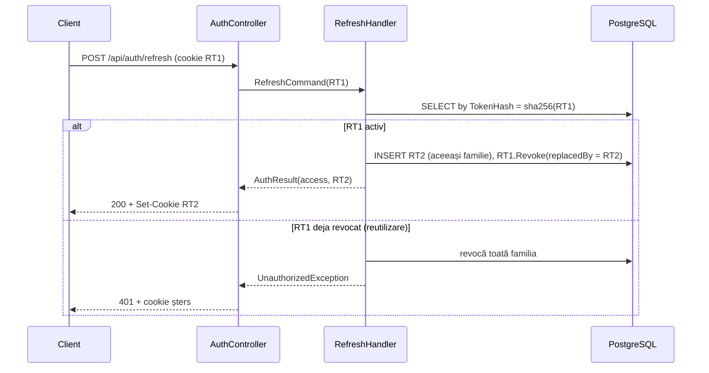

# Spec: Autentificare JWT cu refresh token rotativ (backend)

**Data:** 2026-10-16
**Branch:** `feature/NUT-auth-jwt`
**Faza din roadmap:** Faza 2 (Backend core), Sprint 2
**Status:** design aprobat pe secțiuni; spec în revizuire

---

## 1. Scop

### User story
> Ca utilizator NutriScan, vreau să îmi creez un cont și să mă autentific, ca datele mele nutriționale să fie private și să rămân logat pe telefon și pe laptop în același timp, fără să reintroduc parola la fiecare deschidere a aplicației.

### Criterii de acceptanță
- **AC1:** `POST /api/auth/register` cu email, parolă, prenume și nume valide creează contul și răspunde 201 cu access token și cookie de refresh. Utilizatorul e logat imediat.
- **AC2:** un email deja folosit (indiferent de majuscule și spații) primește 409.
- **AC3:** `POST /api/auth/login` cu credențiale corecte răspunde 200 cu access token și cookie de refresh. Credențialele greșite primesc 401 cu mesaj generic.
- **AC4:** după 5 parole greșite consecutive, contul e blocat 5 minute. În acest interval, inclusiv cu parola corectă, răspunsul e 401 generic.
- **AC5:** `POST /api/auth/refresh` cu cookie valid emite un access token nou și un refresh token nou. Tokenul vechi devine invalid.
- **AC6:** refolosirea unui refresh token deja rotit primește 401 și revocă toată familia lui. Și tokenul curent, cel legitim, devine invalid.
- **AC7:** `POST /api/auth/logout` revocă familia curentă, șterge cookie-ul și răspunde 204. Sesiunile de pe alte dispozitive nu sunt afectate.
- **AC8:** `GET /api/auth/me` fără access token valid răspunde 401, iar cu token valid răspunde 200 cu datele utilizatorului.
- **AC9:** mai mult de 10 cereri pe minut de la același IP pe `/api/auth/*` primesc 429.
- **AC10:** aplicația nu pornește dacă `Jwt:Secret` lipsește sau are sub 32 de octeți.
- **AC11:** cererile cross-origin sunt acceptate doar de la originile configurate în `Cors:AllowedOrigins`.

### În afara scopului
Roluri și autorizare pe politici, confirmare pe email, resetare de parolă, login social (Google etc.), 2FA, ecran de administrare a sesiunilor. Ecranele de login, înregistrare și onboarding din client și interceptorul de refresh aparțin Fazei 3 și vor avea spec separat. Completarea profilului fizic (`PUT /api/profile`) aparține modulului Profil.

---

## 2. Decizii luate (rezumat pentru ADR-002)

| # | Întrebare | Decizie | Alternative respinse |
|---|---|---|---|
| D1 | Câte sesiuni per utilizator? | Tabel separat `RefreshTokens`, câte o familie per login/dispozitiv | Un singur token pe `User`: logarea pe un dispozitiv l-ar deloga pe celălalt |
| D2 | Unde ține clientul tokenurile? | Access token în corpul JSON, păstrat doar în memorie; refresh token în cookie `HttpOnly; Secure; SameSite=Strict; Path=/api/auth` | Ambele în `localStorage` (refresh token furabil prin XSS); ambele în cookie (necesită protecție anti-CSRF) |
| D3 | Ce cere înregistrarea? | Minimal: email, parolă, prenume, nume; profilul fizic se completează pe un ecran de onboarding separat | Formular complet: cuplează auth de calculele BMR/TDEE și e greoi pe mobil |
| D4 | Hash parolă | `PasswordHasher<User>` (PBKDF2-HMAC-SHA512, 210.000 iterații, recomandarea OWASP 2023), în spatele `IPasswordHasher` | Argon2id (dependență terță, parametri reglați manual); BCrypt (trunchiere la 72 de octeți); ASP.NET Identity complet (tabele proprii, conflict cu `User`) |
| D5 | Hash refresh token | SHA-256, index unic | Hash lent: inutil pentru 256 de biți de entropie și ar împiedica căutarea după index |
| D6 | Semnătura JWT | HS256, secret simetric | RS256: util doar dacă alte servicii validează tokenul; OCR nu primește JWT |
| D7 | Brute-force | Rate limit per IP (10/min) + blocare cont 5 min după 5 eșecuri + verificare cu hash fals când utilizatorul nu există (timp constant) | Blocare lungă sau permanentă: un atacator ar putea bloca victime la nesfârșit (DoS) |

---

## 3. Arhitectură

### 3.1 Componente pe straturi

**Domain** (`NutriScan.Domain`)
- `Entities/RefreshToken.cs`: entitate nouă (vezi 3.2), cu `IsActive(DateTime nowUtc)`, `IsExpired(DateTime nowUtc)` și `Revoke(DateTime nowUtc, Guid? replacedByTokenId = null)`. A doua revocare aruncă `DomainException`.
- `Entities/User.cs`:
  - se șterg `RefreshToken` și `RefreshTokenExpiryTime`;
  - se adaugă `FailedLoginAttempts` (int), `LockoutEndUtc` (DateTime?) și colecția `RefreshTokens`;
  - metode noi: `IsLockedOut(DateTime nowUtc)`, `RegisterFailedLogin(DateTime nowUtc)` (la al 5-lea eșec setează `LockoutEndUtc = now + 5 min` și resetează contorul) și `RegisterSuccessfulLogin()`;
  - proprietate calculată `IsProfileComplete => HeightCm > 0 && WeightKg > 0` (nemapată în DB).

**Application** (`NutriScan.Application`)
- `Common/Interfaces/IPasswordHasher.cs`: `string Hash(string password)`; `PasswordCheckResult Verify(string hash, string password)` cu valorile `Failed`, `Success`, `SuccessRehashNeeded`.
- `Common/Interfaces/ITokenService.cs`: `AccessToken CreateAccessToken(User user)` (returnează `Token` și `ExpiresAtUtc`); `string GenerateRefreshToken()`; `string HashRefreshToken(string token)`.
- `Common/Interfaces/IDateTimeProvider.cs`: `DateTime UtcNow { get; }`.
- `Common/Interfaces/IApplicationDbContext.cs`: se adaugă `DbSet<RefreshToken> RefreshTokens`.
- `Common/Exceptions/ConflictException.cs`, `UnauthorizedException.cs`.
- `Auth/Commands/Register/`: `RegisterCommand`, `RegisterCommandValidator`, `RegisterCommandHandler`.
- `Auth/Commands/Login/`: idem.
- `Auth/Commands/Refresh/`: `RefreshCommand(string RefreshToken)` și handler-ul.
- `Auth/Commands/Logout/`: `LogoutCommand(string? RefreshToken)` și handler-ul.
- `Auth/Queries/GetCurrentUser/`: `GetCurrentUserQuery(Guid UserId)` și handler-ul.
- `Auth/Dtos/`: `AuthResult` (access token, data expirării, refresh token în clar, `UserDto`), `UserDto`.

Handler-ele returnează refresh token-ul în clar către WebApi, singurul strat care știe de cookie-uri. Tokenul în clar nu e salvat nicăieri.

**Infrastructure** (`NutriScan.Infrastructure`)
- `Identity/PasswordHasherService.cs`: adaptor peste `Microsoft.AspNetCore.Identity.PasswordHasher<User>` cu `IterationCount = 210_000`. Pachet nou: `Microsoft.Extensions.Identity.Core`.
- `Identity/JwtTokenService.cs`: implementează `ITokenService` folosind `System.IdentityModel.Tokens.Jwt` / `Microsoft.IdentityModel.JsonWebTokens` și `RandomNumberGenerator.GetBytes(32)` (Base64Url).
- `Identity/JwtOptions.cs`: `Secret`, `Issuer`, `Audience`, `AccessTokenMinutes` (15), `RefreshTokenDays` (7), validate la pornire (`ValidateOnStart`, secret de minimum 32 de octeți).
- `Common/SystemDateTimeProvider.cs`.
- `Persistence/ApplicationDbContext.cs`: configurarea `RefreshToken` (vezi 3.2); `User.IsProfileComplete` ignorat.
- Migrare `AddRefreshTokensAndLockout`.

**WebApi** (`NutriScan.WebApi`)
- `Controllers/AuthController.cs`: controller subțire. Construiește comanda, apelează `ISender`, scrie și șterge cookie-ul `nutriscan_rt` și mapează `AuthResult` la răspunsul JSON (fără refresh token în corp).
- `Infrastructure/GlobalExceptionHandler.cs`: `IExceptionHandler` care produce `ProblemDetails`.
- `Program.cs`: `AddAuthentication().AddJwtBearer(...)`, `AddAuthorization()`, `AddRateLimiter(...)` cu politica `auth`, `AddExceptionHandler<GlobalExceptionHandler>()` + `AddProblemDetails()` și CORS `Frontend` cu origini din configurare și `AllowCredentials()`.
- `appsettings.json`: `Jwt:ExpiryMinutes` devine `Jwt:AccessTokenMinutes = 15`, iar `Jwt:RefreshTokenExpiryDays` devine `Jwt:RefreshTokenDays = 7`; se adaugă `Cors:AllowedOrigins = ["http://localhost:3000"]`. Secretul **nu** apare aici.

### 3.2 Model de date

```
RefreshTokens
├── Id                 uuid PK
├── UserId             uuid FK → Users(Id) ON DELETE CASCADE
├── TokenHash          varchar(64) NOT NULL, UNIQUE   (SHA-256, hex)
├── FamilyId           uuid NOT NULL, INDEX
├── CreatedAtUtc       timestamptz NOT NULL
├── ExpiresAtUtc       timestamptz NOT NULL
├── RevokedAtUtc       timestamptz NULL
└── ReplacedByTokenId  uuid NULL

Users (modificări)
├── − RefreshToken, RefreshTokenExpiryTime
├── + FailedLoginAttempts  int NOT NULL DEFAULT 0
└── + LockoutEndUtc        timestamptz NULL
```

Tokenurile expirate sau revocate rămân în tabel. Curățarea lor periodică e în afara scopului și va fi notată ca datorie tehnică în ADR-002.

---

## 4. Contract API

Bază: `/api/auth`. JSON în camelCase. Erorile sunt `ProblemDetails` (RFC 7807).

| Metodă și rută | Auth | Corp cerere | Succes | Erori |
|---|---|---|---|---|
| `POST /register` | — | `{ email, password, firstName, lastName }` | 201 `AuthResponse` + `Set-Cookie` | 400, 409, 429 |
| `POST /login` | — | `{ email, password }` | 200 `AuthResponse` + `Set-Cookie` | 400, 401, 429 |
| `POST /refresh` | cookie | — | 200 `AuthResponse` + `Set-Cookie` nou | 401 (+ cookie șters), 429 |
| `POST /logout` | cookie (opțional) | — | 204 + cookie șters | 429 |
| `GET /me` | Bearer | — | 200 `UserDto` | 401 |

```jsonc
// AuthResponse
{
  "accessToken": "eyJhbGciOi...",
  "accessTokenExpiresAtUtc": "2026-10-16T12:15:00Z",
  "user": { /* UserDto */ }
}

// UserDto
{
  "id": "3f2a…",
  "email": "ana@exemplu.ro",
  "firstName": "Ana",
  "lastName": "Pop",
  "isProfileComplete": false
}
```

**Cookie:** `nutriscan_rt=<token>; HttpOnly; Secure; SameSite=Strict; Path=/api/auth; Max-Age=604800`. La ștergere se trimite același nume și path, cu dată de expirare în trecut.

**Validare (FluentValidation):**
- `email`: obligatoriu, format valid, maximum 256 de caractere; normalizat cu `Trim().ToLowerInvariant()` înainte de salvare și căutare.
- `password`: 8–128 caractere, fără reguli de compoziție (NIST SP 800-63B).
- `firstName`, `lastName`: obligatorii după trim, maximum 100 de caractere.
- La login, validatorul verifică doar câmpurile nevide și lungimea maximă. Nu aplică regula de minimum 8, ca să nu dezvăluie politica de parolă.

**Maparea excepțiilor (GlobalExceptionHandler):**

| Excepție | Status | `title` |
|---|---|---|
| `FluentValidation.ValidationException` | 400 | „Date invalide” + `errors: { câmp: [mesaje] }` |
| `ConflictException` | 409 | mesajul excepției |
| `UnauthorizedException` | 401 | „Email sau parolă incorectă” / „Sesiune invalidă” |
| orice altceva | 500 | „A apărut o eroare neașteptată” (fără detalii; excepția se loghează) |

---

## 5. Fluxuri

### 5.1 Register
1. Validare, normalizare email.
2. Email existent → `ConflictException` (409). Indexul unic din DB rămâne plasa de siguranță pentru cereri concurente: `DbUpdateException` pe încălcarea unicității este tradusă tot în 409.
3. Creează `User` cu `PasswordHash = hasher.Hash(password)`.
4. Emite tokenurile (pașii 5.2.5–5.2.6, cu `FamilyId` nou) și salvează totul într-un singur `SaveChangesAsync`.

### 5.2 Login
1. Validare, normalizare email, încărcarea utilizatorului.
2. Utilizator inexistent → `hasher.Verify(DummyHash, password)` (pentru timp constant), apoi 401.
3. `user.IsLockedOut(now)` → 401 (fără a verifica parola și fără a incrementa contorul).
4. Parolă greșită → `user.RegisterFailedLogin(now)`, salvare, 401.
5. Parolă corectă → `user.RegisterSuccessfulLogin()`. Dacă rezultatul e `SuccessRehashNeeded`, se recalculează hash-ul.
6. `refresh = GenerateRefreshToken()`; se salvează `RefreshToken { TokenHash = Hash(refresh), FamilyId = Guid.NewGuid(), ExpiresAtUtc = now + 7 zile }`.
7. Se returnează `AuthResult`.

### 5.3 Refresh (cu detectarea reutilizării)
1. Cookie lipsă → 401.
2. Caută după `TokenHash`. Negăsit → 401.
3. Token **revocat** → **reutilizare detectată**: revocă toate tokenurile active cu același `FamilyId`, salvează, loghează un avertisment (fără token), 401.
4. Token expirat → 401.
5. Altfel: emite un token nou cu același `FamilyId`, apelează `old.Revoke(now, new.Id)`, emite access token nou, salvează și returnează.

Concurență: două cereri simultane cu același token (de exemplu două tab-uri) pot face ca a doua să fie tratată drept reutilizare și să delogheze utilizatorul. Comportamentul e acceptat pentru această fază. Clientul din Faza 3 va serializa refresh-urile (o singură cerere de refresh în zbor).



### 5.4 Logout
Cookie prezent și găsit → revocă tokenurile active din familia lui. Indiferent de rezultat, cookie-ul se șterge și răspunsul e 204.

### 5.5 Me
`[Authorize]`. Id-ul utilizatorului se citește din claim-ul `sub` (cu `MapInboundClaims = false`), apoi se returnează `UserDto`. Dacă utilizatorul nu mai există, răspunsul e 401.

---

## 6. Securitate

- **JWT:** HS256; claims `sub`, `email`, `jti`, `iat`; validare issuer, audience, durată și cheie; `ClockSkew = 30 s`.
- **Secret:** `Jwt__Secret` din mediu (`docker-compose.yml` / `.env`) sau `dotnet user-secrets` local. Fail-fast la pornire (AC10).
- **Rate limiting:** `AddRateLimiter` cu `FixedWindowRateLimiter` partiționat pe IP (`HttpContext.Connection.RemoteIpAddress`), 10 cereri / 60 s, `[EnableRateLimiting("auth")]` pe `AuthController`, `RejectionStatusCode = 429`. Pentru testele de integrare limita poate fi configurată (`RateLimiting:AuthPermitLimit`).
- **CORS:** politica `Frontend` cu `WithOrigins(Cors:AllowedOrigins)`, `AllowAnyHeader`, `AllowAnyMethod` și `AllowCredentials`. Politica `AllowAll` se șterge.
- **Loguri:** parolele, tokenurile și hash-urile nu se loghează niciodată.
- **Cookie `Secure` în dezvoltare:** browserele tratează `http://localhost` ca origine sigură, deci cookie-ul funcționează local. În producție e obligatoriu HTTPS.

---

## 7. Testare

**Domain.UnitTests:**
- `RefreshTokenTests`: activ / expirat / revocat; `Revoke` setează data și `ReplacedByTokenId`; dubla revocare aruncă excepție.
- `UserLockoutTests`: 4 eșecuri → nu e blocat; al 5-lea → blocat până la `now + 5 min`; după expirare → deblocat; login reușit → contor 0; `IsProfileComplete`.

**Application.UnitTests** (Moq pentru `IPasswordHasher`, `ITokenService`, `IDateTimeProvider`; EF Core InMemory pentru `IApplicationDbContext`; pachet nou `Microsoft.EntityFrameworkCore.InMemory`):
- validatoarele pentru register și login (cazuri limită: 7 / 8 / 128 / 129 caractere, email invalid, nume goale);
- `RegisterCommandHandler`: normalizează email-ul; email duplicat → `ConflictException`; creează un token de refresh;
- `LoginCommandHandler`: utilizator inexistent → `Verify` apelat oricum + `UnauthorizedException`; parolă greșită → contor incrementat; cont blocat → 401 fără verificarea parolei; succes → contor resetat + familie nouă;
- `RefreshCommandHandler`: rotație corectă; token revocat → toată familia revocată; token expirat → 401;
- `LogoutCommandHandler`: revocă doar familia curentă, nu și alte familii ale aceluiași utilizator.

**WebApi.IntegrationTests** (proiect nou: `Microsoft.AspNetCore.Mvc.Testing`, `Testcontainers.PostgreSql`; necesită Docker):
- câte un test end-to-end pentru fiecare dintre AC1–AC9 și AC11, inclusiv atributele cookie-ului (`HttpOnly`, `Secure`, `SameSite=Strict`, `Path=/api/auth`);
- AC10 se acoperă printr-un test unitar pe validarea `JwtOptions`.

Toate testele urmează tiparul Arrange-Act-Assert și numirea `Metoda_Scenariu_RezultatAșteptat`.

---

## 8. Livrare și documentație

- Commit-uri *Conventional Commits* pe `feature/NUT-auth-jwt`, apoi merge în `develop` după ce build-ul și toate testele trec.
- `aplicatie/docs/adr/ADR-002-authentication-strategy.md`: deciziile D1–D7, alternativele respinse și datoria tehnică (curățarea tokenurilor expirate, concurența la refresh).
- `aplicatie/docs/architecture_and_contracts.md`: diagrama de secvență din 5.3 și `RefreshToken` în ERD; secțiunea de auth actualizată cu contractul din 4.
- `aplicatie/docs/sprints/sprint-02.md`: pornit în stilul Sprint 1.
- Fișierul local de întrebări pentru comisie: actualizat pe disc, **fără commit**.
